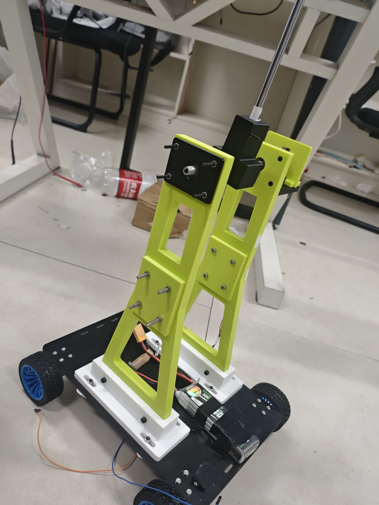

# 四轮车载倒立摆 · 校赛项目记录

[GitHub 仓库](https://github.com/lingkonglengfeng/nanhua-pendulum-car) · [MIT License](LICENSE) · [第三方许可说明](THIRD_PARTY_NOTICES.md)

这个项目是参加南华电赛运控组校赛制作的一辆四轮车载单轴倒立摆小车。比赛要求摆杆能够从最低点起摆，并保持倒立，因此采用了龙门架式结构。校赛已经结束，准备把这次用到的控制代码、机械模型和调试记录整理出来，作为一次完整的项目留档，也供做类似项目的同学参考。

仓库包含 STM32F103 固件、自制转接板工程与原理图、摆架和底盘的参数化建模脚本、STEP / STL / DXF 文件，以及串口调试工具。除了代码本身，也希望记录从电机能转，到反馈方向正确，再到直立、起摆和运动控制的排查过程。

> 当前是开源整理初稿。整理时核对的固件版本为 `0x103C8048`（v48），后续以源码为准。个人复盘、硬件资料和实物照片已补充，比赛现场表现和演示视频后续补充；代码中有某项功能，不等于已经完成该功能的比赛验收。



*作者提供的小车实物照片。机械模型可另看 [V3 摆架 CAD 示意](pendulum_v3/output/preview/assembly.png)。*

## 从哪里开始看

- 想看代码：从 [F103 工程说明](f103_bringup/README.md) 开始。
- 想看硬件板子：看 [转接板工程、原理图与已知问题](hardware/adapter-board/README.md)。
- 想看机械结构：先看 [建模文件与版本对应](docs/建模文件与版本.md)。
- 想看调试过程：看 [调试过程整理](docs/调试过程.md)，其中链接了各阶段的原始记录。
- 想看作者的碎碎念：见 [校赛复盘与个人经验](docs/校赛复盘与个人经验.md)，记录了方案更换、调试取舍与 AI 辅助的体会。

## 硬件与软件概况

| 项目 | 当前代码 / 文件对应内容 |
| --- | --- |
| 主控 | STM32F103C8T6，Cortex-M3，目标时钟 72 MHz |
| 电机 | 四台带编码器的 370 减速电机；当前换算按 11 线、A 相双边沿、减速比 21.3 |
| 电机驱动 | 两块 AT8236 双路模块，四路电机独立输出 |
| 摆角传感器 | AS5600，PB8 / PB9 软件 I²C |
| 控制周期 | FreeRTOS 控制任务，5 ms / 200 Hz |
| 调试接口 | USART3，115200 / 8N1；串口命令、日志和 Keil Watch |
| 底盘模型 | V3，300 × 200 × 4 mm，轮组安装孔距 14 × 16 mm |
| 机械输出 | STEP 装配与零件、STL / 3MF 打印件、DXF 底板轮廓及孔位表 |

早期还有 G474 主控及不同驱动方案的选型资料。它们用于说明设计过程，当前固件入口是 `f103_bringup/`。摆架 V3 与配重模型按 Ø8 铝管设计，后期固件调试记录涉及实心铁棒；最终比赛摆杆的实物尺寸、重量及结构改动待补充。

## 自制转接板与实物接线

为了减少分散飞线，我设计了转接板，把主控、电机驱动、编码器和 AS5600 等接口集中起来。这里一并提供 [嘉立创EDA工程](hardware/adapter-board/电赛转接板.epro2) 和 [原理图 PDF](hardware/adapter-board/电赛转接板.pdf)。

这版板子仍有设计纰漏，最后在实物上通过飞线解决。公开的工程和原理图保留了原始设计，不能当作已回填所有实物修正的版本。具体说明见 [硬件资料与已知问题](hardware/adapter-board/README.md)。


*小车底部安装情况。实物接线包含调试期间的修改，具体飞线起止点尚待整理。*

## 当前代码包含的功能

- 四路编码器采集、轮速估计、单轮速度 PID 和单轮参数调整。
- 固定引脚上的双向慢衰减电机驱动，采用定时器触发 GPIO DMA。
- AS5600 角度采集、跨圈处理、滤波和最低点零点标定。
- 直立控制、速度外环、平衡点微调和基于编码器里程的位置保持。
- 自动起摆与顶端接管，以及直立时的直行、差速转向和位置序列。
- `BALSTEP`：起点保持 5 秒、前进默认 1 米、终点保持 5 秒，随后继续保持终点。
- 串口命令、运行日志、退出原因诊断和浏览器串口曲线工具。

具体指令、接受条件和版本差异见 [串口控制指令](f103_bringup/docs/串口控制指令.md)。位置与距离来自轮轴编码器里程，实际运动会受轮径、打滑和机械差异影响。

## 目录导航

保留现有目录名，便于模型脚本读取同级依赖，也便于对照原来的调试记录。

```text
.
├── f103_bringup/                  # 当前 F103 固件、调试工具与分阶段记录
│   ├── Core/                     # 应用代码、驱动与控制算法
│   ├── Drivers/                  # STM32 HAL / CMSIS
│   ├── Middlewares/              # FreeRTOS
│   ├── MDK-ARM/                  # Keil 工程及现有构建/检查脚本
│   ├── tools/                    # 串口曲线工具与日志分析脚本
│   └── docs/                     # 原始技术调试记录，含历史版本
├── pendulum_v3/                  # V3 摆架、AS5600 安装结构
├── chassis_fr4_v3_300x200/        # V3 底板
├── pcb_bottom_adapter_v2_center/ # 底盘中央 PCB 安装转接件
├── pendulum_rod_weight/          # 可调配重附件
├── vehicle_assembly_v1/          # 早期整车参考装配
├── pendulum_v1/、pendulum_v2/    # 摆架历史版本及对照依赖
├── chassis_fr4_v1/、chassis_fr4_v2_direct/
├── wheelset_14x16_v1/            # 早期轮组转接件
├── pcb_bottom_adapter_v1/        # 早期 PCB 安装版本
├── wiring_dmg474_drv8871/        # 早期 G474 接线与驱动选型过程
├── hardware/adapter-board/       # 自制转接板工程、原理图与已知问题
└── docs/                        # 整理后的阅读入口与个人复盘
```

## 编译与查看

### 固件

1. 使用 Keil MDK 打开 [`f103_bringup.uvprojx`](f103_bringup/MDK-ARM/f103_bringup.uvprojx)。当前工程选择 ARM Compiler 5.06 update 5，设备包为 `Keil.STM32F1xx_DFP.2.2.0`。
2. 编译工程。下载到自己的硬件前，先核对 [当前接线与轮位](f103_bringup/README.md#当前接线与轮位)，再按单轮、传感器、直立、起摆的顺序检查。
3. 使用 ST-Link 下载和调试，通过 `g_fw_build` 确认运行版本。

CubeMX 配置文件在 [`f103_bringup.ioc`](f103_bringup/f103_bringup.ioc)。直接编译不需要重新生成代码；需要重新生成时，先看 [骨架与回归说明](f103_bringup/docs/CubeMX骨架与回归说明.md)。

### 机械模型

- CAD 查看和加工沟通使用 STEP；打印使用分件 STL / 3MF；底板轮廓使用 DXF。文件单位为 mm。
- 各子目录 `output/preview/` 中有预览图片和离线 HTML；HTML 下载后用浏览器打开，GitHub 文件页本身不运行三维查看器。
- 修改参数后重新建模的入口、目录依赖和旧模型限制见 [建模文件与版本对应](docs/建模文件与版本.md)。

### 串口曲线工具

进入 [`tools/as5600-monitor/`](f103_bringup/tools/as5600-monitor/)，运行 `打开实时曲线.cmd`，或用支持 Web Serial 的 Edge / Chrome 打开该目录的 `as5600-monitor.html`。波特率为 115200。

工具能显示摆角、角速度、控制输出、起摆阶段和传感器状态，也能导出 CSV。自带历史日志可用于熟悉界面；连接串口本身不会启动电机。更多说明见 [工具 README](f103_bringup/tools/as5600-monitor/README.md)。

## 调试过程与经验

现有资料按下面的顺序整理，详细过程见 [调试过程整理](docs/调试过程.md)：

1. 先确认供电、启动配置和编码器信号，再逐轮验证电机通道、反馈映射和方向。
2. 用固定输出区分驱动问题与 PID 问题，再做单轮速度闭环。
3. 检查采样周期、串口负载和测速尖峰，区分真实运动与测量噪声。
4. 标定最低点、核对摆角与控制极性，再调直立环、速度外环和位置保持。
5. 自动起摆时同时看顶端角度、角速度和预测角，结合状态日志判断为何接管或退出。
6. 最后再加入直行、转向和定时运动流程，按实物与日志记录结果。

上面是按源码和记录整理的技术过程。下面这段是我自己的调试体会，完整版本见 [校赛复盘与个人经验](docs/校赛复盘与个人经验.md)。

### 一些调车的碎碎念

我原本不会建模，所以这次从第一版龙门架结构开始，就用了很多 AI 辅助。最初选的是 AS5600 加正点原子的电机控制板。我不太喜欢飞很多线，就参考原理图做了第一版转接板，利用板上已有的简牛接口连接电机和磁编码器。后来测试时发现连接有问题，主控板也疑似因短接损坏，最后放弃这套方案，换成 F103，重新画了第二版板子，软件用 FreeRTOS 来组织任务。

不过，自己设计的转接板也还是有纰漏，最后又靠飞线解决了实物上的问题。这次也把工程、原理图和照片一起放出来，保留这段实际调试过程。

回头看，前期选型经验不足还是留下了不少问题。所选轮组的编码器分辨率偏低，后续调参时，把目标速度设成 0，也很难让小车持续留在原点。转向环做过，但效果不理想；时间有限，最后也没有继续做循迹。这些都是这次项目实际留下的不足。

起摆部分我也学习过动态正弦策略，不过就这次车上的调试感受而言，AI 辅助实现的能量控制策略更适合一些。整个项目里，AI 的辅助确实占了很大一部分，这一点我也想如实记录下来。

这次最大的感受是：有想法以后，还是要勇敢跨出舒适圈去试。AI 让很多事情的入门成本低了很多，但想法落地仍然要靠行动和实践。理论也可以边做边学，带着实际问题回头理解，往往会更深。希望这些代码、模型和踩坑记录，能给看到这里的人带来一点帮助。

## 版本与复现说明

当前源码是赛后整理时保留的开发版本，尚未将某个源码快照确认成“比赛最终版”。历史文档中的轮位、参数、引脚用途和固件号可能属于当时的版本，阅读时先看文档开头，再对照当前源码和 F103 工程说明。

本次整理只修改说明与发布忽略规则，没有改动控制程序、参数或机械几何，也没有重新烧录实车。已有构建结果和测试数据属于原调试记录，不视为本次重新验证的结果。

## 开源范围与许可

本项目原创的应用代码、建模脚本、硬件设计、机械输出文件和项目文档采用 [MIT License](LICENSE)。欢迎在保留版权和许可声明的前提下使用与修改。

STM32 HAL、CMSIS、FreeRTOS 和三维预览使用的第三方库保留各自版权与许可证，具体入口见 [第三方许可说明](THIRD_PARTY_NOTICES.md)。厂商整套资料盘、本机虚拟环境、编译缓存、重复压缩包及运行时临时文件已加入忽略规则。整理范围与后续补充项见 [发布整理记录](docs/发布准备.md)。
