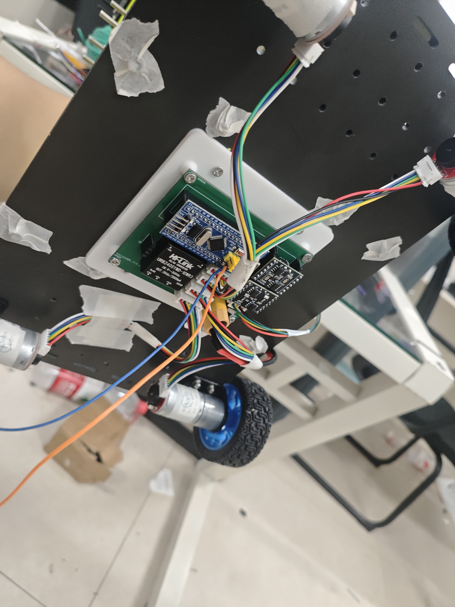

# 电赛转接板

这是作者为本次倒立摆小车设计的硬件转接板资料，对应后期 F103 方案。原始工程和原理图按提供时的内容归档。

## 文件

| 文件 | 内容 |
| --- | --- |
| [电赛转接板.epro2](电赛转接板.epro2) | 嘉立创EDA工程源文件，用于查看与继续修改设计 |
| [电赛转接板.pdf](电赛转接板.pdf) | 单页原理图，可直接查看接口与网络连接 |
| [小车底部实物照片](../../docs/images/car-underside.jpg) | 转接板、F103 核心板、驱动模块与线束的实际安装情况 |

工程元数据记录的编辑器版本为 `3.2.149.88089769`；打开工程时可据此选择兼容的嘉立创EDA版本。PDF 图框标注为 V1.0，该标注不用于区分作者口述中的第一版、第二版转接方案。

## 原理图内容

原理图包含 F103 核心板信号转接、四路电机连接、两块 AT8236 双路电机驱动接口、AS5600 接口、3S 电源输入、12 V → 5 V 电源模块及定位孔。

作者最初为了减少飞线，在正点原子控制板方案中利用板上简牛接口设计转接板；放弃该主控方案后，又为 F103 重新设计了板子。本目录归档的是本次提供的 F103 工程，早期 G474 接线资料仍在仓库的 `wiring_dmg474_drv8871/` 目录。

## 已知问题与实物飞线修改

**这版设计仍有纰漏，作者在实物调试中通过飞线完成了修正。归档的工程和 PDF 应作为原始设计资料参考，不能视为已经回填全部实物修改的修正版。**

目前尚未整理每根修正飞线的起止焊点、对应网络及修改原因，因此不从照片推断具体改线方法。之后补齐时，可按“原连接、实际问题、飞线后的连接”逐项记录。

原理图网络名含有设计时的轮位缩写；本车后来通过逐轮测试确认的电机通道与编码器对应关系，统一查看 [当前 F103 接线与轮位](../../f103_bringup/README.md#当前接线与轮位)。照片可用于了解安装布局，具体接线还需结合原理图、当前代码与实际飞线核对。

## 实物安装

*作者提供的小车底部照片，记录当时实际安装和接线状态。*
